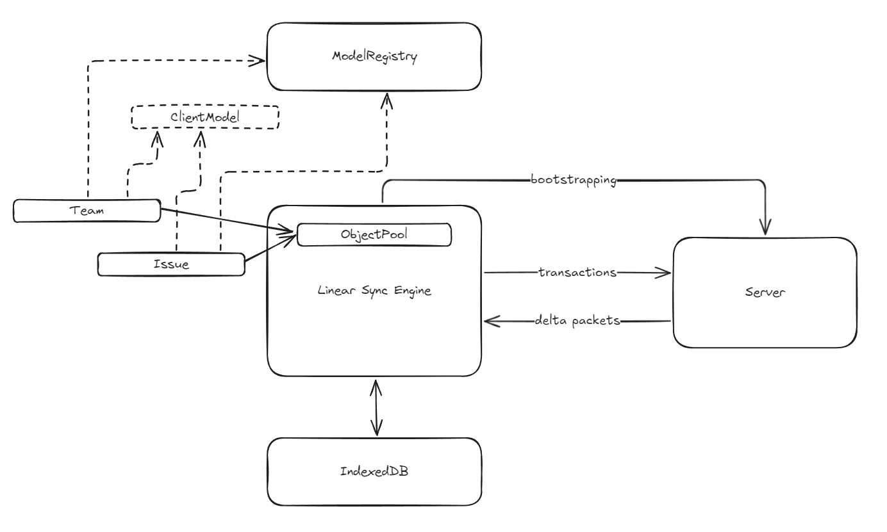

# Summary

This summary covers the reverse-engineering study of Linear's Sync Engine (LSE). It provides a conceptual overview of how LSE works and serves as a good starting point for understanding the source code.

## Introduction

Here are the core concepts behind LSE:

**Model**

Entities such as `Issue`, `Team`, `Organization`, and `Comment` are referred to as **models** in LSE. These models possess **properties** and **references** to other models, many of which are observable (via **MobX**) to automatically update views when changes occur. In essence, models and properties include **metadata** that dictate how they behave in LSE.

Models can be loaded from either the **local database** (IndexedDB) or the server. Some models supports **partially loading** and can be loaded on demand, either from the local database or by fetching additional data from the server. Once loaded, models are stored in an **Object Pool**, which serves as a large map for retrieving models by their **UUIDs**.

Models can be **hydrated** lazily, meaning its properties can be loaded only when accessed. This mechanism is particularly useful for improving performance by loading only the necessary data.

Operations—such as additions, deletions, updates, and archiving—on models, their properties, and references are encapsulated as **transactions**. These transactions are sent to the server, executed there, and then broadcast as **delta packets** to all connected clients. This ensures data consistency across multiple clients.

**Transaction**

Operations sent to the server are packaged as **transactions**. These transactions are intended to execute **exclusively** on the server and are designed to be **reversible** on the client in case of failure. If the client loses its connection to the server, transactions are temporarily **cached** in IndexedDB and automatically resent once the connection is reestablished.

Transactions are associated with a **sync id**, which is a monotonically increasing number that ensures the correct order of operations. This number is crucial for maintaining consistency across all clients.

Additionally, transactions play a key role in supporting **undo** and **redo** operations, enabling seamless changes and corrections in real-time collaborative workflows.

**Delta packets**

Once transactions are executed, the server broadcasts **delta packets** to all clients—including the client that initiated the transaction—to update the models. A delta packet contains several **sync action**s, and each action is associated with a **sync id** as well. This mechanism prevents clients from missing updates and helps identify any missing packets if discrepancies occur.

The **delta packets** may differ from the original transactions sent by the client, as the server might perform **side effects** during execution (e.g., generating history).

## Defining Models and Metadata

When Linear starts, it first generates metadata for models, including their properties, methods (actions), and computed values. To manage this metadata, LSE maintains a detailed dictionary called `ModelRegistry`.

LSE uses **decorators** to define models and properties, and record their metadata to the `ModelRegistry`.

Model's metadata includes:

1. **`loadStrategy`**: Defines how models are loaded into the client. There are five strategies:
   - **`instant`**: Models that are loaded during application bootstrapping (default strategy).
   - **`lazy`**: Models that do not load during bootstrapping but are fetched all at once when needed (e.g., `ExternalUser`).
   - **`partial`**: Models that are loaded on demand, meaning only a subset of instances is fetched from the server (e.g., `DocumentContent`).
   - **`explicitlyRequested`**: Models that are only loaded when explicitly requested (e.g., `DocumentContentHistory`).
   - **`local`**: Models that are stored exclusively in the local database. No models have been identified using this strategy.
2. **`partialLoadMode`**: Specifies how a model is hydrated, with three possible values: `full`, `regular`, and `lowPriority`.
3. **`usedForPartialIndexes`**: Relates to the functionality of partial indexing.

Property's metadata includes:

1. `type`: Specifies the property's type.
2. `lazy`: Specifies whether the property should be loaded only when the model is hydrated.
3. `serializer`: Defines how to serialize the property for data transfer or storage.
4. `indexed`: Determines whether the property should be indexed in the database. Used for references.
5. `nullable`: Specifies whether the property can be `null`, used for references.
6. etc.

`type` is an enumeration that includes the following values:

1. **`property`**: A property that is "owned" by the model. For example, `title` is a `property` of `Issue`.
2. **`ephemeralProperty`**: Similar to a `property`, but it is not persisted in the database. This type is rarely used. For example, `lastUserInteraction` is an ephemeral property of `User`.
3. **`reference`**: A property used when a model holds a reference to another model. Its value is typically the ID of the referenced model. A reference can be lazy-loaded, meaning the referenced model is not loaded until this property is accessed. For example, `subscription` is a `reference` of `Team`.
4. **`referenceModel`**: When `reference` properties are registered, a `referenceModel` property is also created. This property defines getters and setters to access the referenced model usin