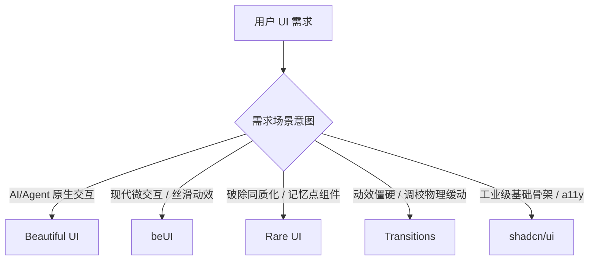

# AI UI Taste & Component Curation Skill

> **核心法则**：写业务逻辑是 AI 的强项，但默认生成的 UI 往往是毫无个性的“大模型平均审美”（泛滥的紫蓝渐变、粗糙大圆角卡片、毫无呼吸感的生硬过渡）。
> 使用本 Skill，根据场景意图直接向顶级开源组件库“抄作业”，将设计骨架与动效参数无缝融入当前工程。

---

## 选型路由决策树 (Intent Routing)

当接收到前端 UI、组件开发或动效调优需求时，严格按照以下意图分流：

### 1. AI 原生交互 (AI-Native Interfaces) 👉 [Beautiful UI](https://beautifului.dev)
- **命中场景**：构建大模型会话、Agent 思考、工具调用、审批流、流式文本。
- **推荐提取原语**：
  - `Thinking State`：可展开折叠的多步骤推理链与思考耗时。
  - `Tool Chips`：紧凑型工具调用胶囊（Running / Completed / Failed）。
  - `Approval Card`：Human-in-the-loop 人类确认卡片。
  - `Streaming Text`：带内联 Sources 引用与 Follow-ups 追问的流式输出。
  - `Prompt Bar`：现代复合输入框（带 `@` 知识库、`/` 指令与模型切换）。

### 2. 现代微交互与灵动感 👉 [beUI](https://beui.dev)
- **命中场景**：需要类似 Apple / Next.js 的高质感交互动效（基于 Framer Motion + Tailwind）。
- **推荐提取原语**：
  - `Dynamic Island`：灵动岛胶囊形变与状态切换。
  - `Morphing Modal`：多步骤弹窗高度平滑形变（Blur Cross-fade）。
  - `Animated Toast Stack`：带层级堆叠与手势滑动的通知栏。
  - `macOS Dock`：带弹性指示器的底部悬浮坞。
  - `Tilt Card`：随光标 3D 悬浮与动态高光卡片。

### 3. 拒绝千篇一律的记忆点 👉 [Rare UI](https://rareui.com)
- **命中场景**：避免像千篇一律的后台系统，做个人主页、Landing Page、创新工具的核心特色区域。
- **推荐提取原语**：
  - `folder-component`：拟物/立体展开的交互式文件夹。
  - `family-drawer`：极致丝滑的非标抽屉。
  - `proximity-sidebar`：随光标距离感应吸附的侧边栏。
  - `gravity-letters` / `gooey-nav`：流体与物理重力特效。

### 4. 专治动效僵硬与机械感 👉 [Transitions](https://transitions.dev)
- **命中场景**：现有弹窗、下拉、Tab 切换显得机械生硬，缺乏呼吸感与物理阻尼。
- **参数直抄规范**：
  - **弹性回弹曲线**：`cubic-bezier(0.34, 1.36, 0.64, 1)` (Bounce)
  - **平滑出入曲线**：`cubic-bezier(0.22, 1, 0.36, 1)` (Smooth Out)
  - **阶梯微延迟**：`stagger: 40ms`
  - **位移与模糊**：位移限制在 `4px ~ 8px`，结合 `2px ~ 3px` 的高斯模糊淡入。

### 5. 工业级项目底座 👉 [shadcn/ui](https://ui.shadcn.com)
- **命中场景**：常规表单、表格、下拉、无障碍访问（a11y）标准、深浅色模式基础架构。
- **原则**：直接通过 CLI 或 Copy 源码，不引入黑盒 npm 依赖。

---

## Agent 执行约束与代码清洗规范

当 Agent 提取上述库的实现时，必须遵守以下步骤：

1. **结构与样式解耦**：
   - 提取其 DOM 层次、弹性布局与 Framer Motion 变体；
   - **严禁**硬编码外部站点的特殊颜色，必须映射为当前工程现有的 Tailwind 语义变量（如 `bg-background`, `text-foreground`, `border-border`）。
2. **动效降级保障**：
   - 始终保留对 `prefers-reduced-motion` 的判断与支持。
3. **保持轻量**：
   - 优先使用 CSS 原生动画与轻量 Transition，必要时再引入 Framer Motion。
