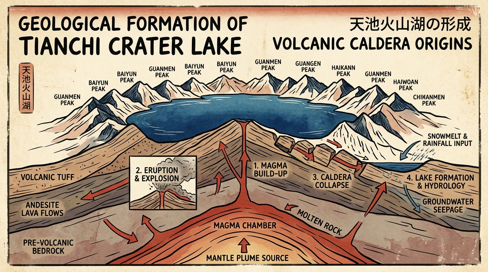

# 为什么现在的旅行，越来越像一场体力活？

现在的旅行，越来越像一场体力活。

打开手机，算法推给你一套又一套完美的图文：同一种色调的九宫格、同一个转角的路标、同一扇能看到日落的窗户。

看到别人的故事，我们下意识的选择，是去追随。

把路线存进收藏夹，买一样的车票，踩着别人踩过的脚印赶场。查不完的避坑指南，做不完的完美攻略。几点起、去哪拍、吃哪家网红店——在别人站过的位置排队，摆出类似的姿势，按下快门。

我们把异国他乡的街头，过成了精确到分钟的 KPI。

我们把别人看过的风景，原封不动地走了一遍。

可那是别人的故事，不是你的。

一座城市活了几百年、上千年，有它的地貌，有它的气候，有几十万人世代生活的规矩和脾气。算法把它切成几个适合拍照的切片，我们就真的以为那几块切片就是全部。

人是到了，照片也有了，但好像只是换了个地方刷手机。

直到很久以后，看到某张照片或者偶然读到一本书，才突然拍大腿：原来当年那个路口，藏着这么有意思的故事？

可那时候，你已经不在现场了。

我不想再要一份密密麻麻的打卡清单。

这次，我只想重新带上好奇心。去看看眼前这座山、这条街、这顿饭背后真正动人的地方。

---

### 那么，以什么样的视角，才能看懂一个地方？

好奇心有了，但我很快遇到了下一个问题：

面对一座陌生的城市，庞大、芜杂、深厚，我到底该以什么样的视角去看它？

如果不去追随网红打卡点，我是不是又会陷入漫无目的的盲转？我不想靠偶然的撞大运，更不想被零碎的推荐牵着鼻子走。

直到我翻开了中国的《方志学》。

从宋元到明清，古人给一座府、一个县编修志书，从来不是想到哪儿写到哪儿。翻开历朝历代的《府志》《县志》，体例永远是严谨的八个卷帙：

舆地、沿革、人物、营造、风俗、物产、艺文、市集。

地貌如何形成、历史如何演变、谁曾在此留下足迹、屋舍城池如何修筑、当地人敬畏什么神明、水土出产什么风物、山川刻着怎样的字句，以及晨昏集市里冒着怎样的市井烟火。

这是祖先在两千年的时间里，摸索出来描摹一块土地最完整、不遗漏的骨架。

我想，放到今天也合适。

```
                     1. 历史沿革 ───┬─── 2. 名人行纪
                                    │
                     3. 地质自然 ───┼─── 4. 乡土营造 
                                    │
                     5. 信仰民俗 ───┼─── 6. 风物饮食 
                                    │
                     7. 诗赋文学 ───┴─── 8. 市井活态 
```

---

### 骨架有了，然后呢？

有了这套骨架，看一个地方不再是盲人摸象。但随之而来的问题是：去哪里找这些信息？

古籍县志晦涩难读，学术专著门槛太高。但在今天的网络上，其实散落着大量极好的内容：

- 电视台与专业制作组拍出的**精品纪录片**，把亿万年的地质演变和山川演化讲得清楚生动；
- 独立学者与文史爱好者写的**网站博客**，记录着鲜为人知的实地考据与老城掌故；
- **B站、抖音**上那些真正懂行的创作者，用镜头拆解古建梁架，重现古战场与贸易商道；
- **小红书**上也有那些走入偏远村落的行者，记录下老瓦当、手艺人与真实的人情烟火。

这些好内容一直都在，只是被算法推荐的机位和滤镜打散了。

我希望能把关于这八个维度的优质信息，尽可能搜集齐全。不用生硬的说教，而是用生动直白的方式，把事情的来龙去脉讲明白。

我喜欢带着疑问的感觉去学习，去探索。

从小到大，当我们心里揣着一个好奇的问题时，学习从来不是苦差事。带着“为什么”走在路上，眼睛是亮的，周围的一砖一瓦才会从无声的背景板，变成活生生、可以被理解的世界。

如果文字能解答疑问，再加上趣味直观的画，让人一眼就能看懂、一眼就能记住，那该多好。



所以，我想做一个产品。

我不想要又一个催人赶场的打卡软件，也不想要一个千篇一律的攻略生成器。

我想做一本真正属于旅人自己的书。在出发前，输入想去的地方，它以这套两千年的方志骨架为底，搜集全网深度的记录与故事，提炼出几个有趣的问题，配上好懂的插画，装订成册。

带着这本书出门。在路上核实自己的疑问，看懂真实的风景，然后，揣着属于自己的故事回来。